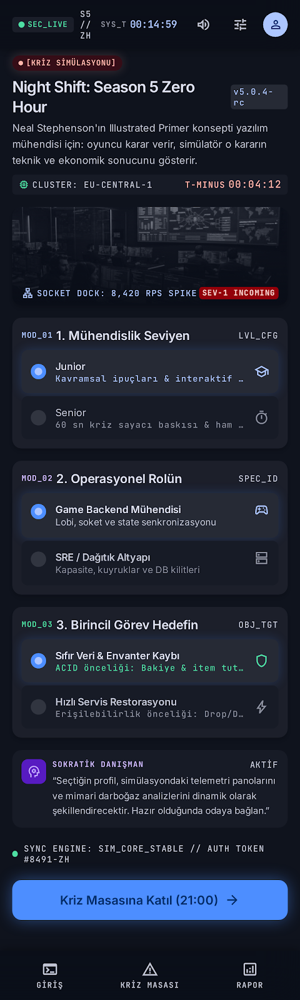
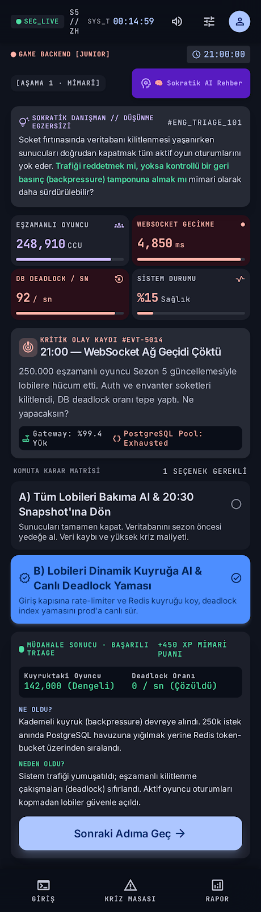
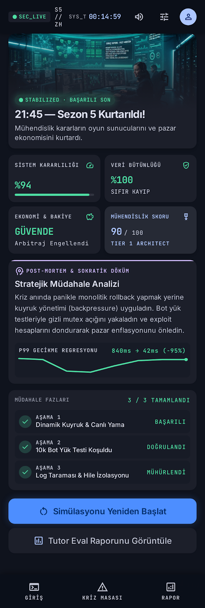

# DESIGN.md — Mobil Tasarım ve Kullanıcı Deneyimi Belgesi

## 1. Tasarım Felsefesi ve Yaklaşımı
"Night Shift: Season 5 Zero Hour", kriz anındaki bir yazılım mühendisinin odaklanmasını artırmak amacıyla **"Command Center / Dark Mode Tactical"** görsel diliyle kurgulanmıştır. Arayüz; bir mobil operasyon terminali hissi verir, dikkat dağıtıcı öğelerden arındırılmıştır ve tüm durum geçişlerinde anlık geri bildirim sunar.

Tasarım prototipi Google Stitch ilkeleri doğrultusunda 3 ana mobil ekrandan oluşur.

---

## 2. Tasarım Sistemi ve Temel Belirteçler (Design Tokens)

* **Görsel Tema:** Dark Terminal / Cyber-Ops (Oyun sunucusu operasyon merkezi).
* **Renk Paleti:**
  * `Background Base`: `#0b0f19` (Derin gece mavisi / siyah)
  * `Surface Card`: `#161e2e` / `#1f293d` (Hafif kalkık operasyon panelleri)
  * `Primary Accent`: `#3b82f6` (Operasyonel mavi / karar butonları)
  * `Danger / Crisis`: `#ef4444` (Kriz göstergeleri, çökme uyarıları)
  * `Success / Stable`: `#10b981` (Dengelenmiş durum, iyi son, doğru mimari)
  * `Warning / Alert`: `#f59e0b` (Kuyruk uyarıları, veri riski bildirimleri)
  * `Tutor Socratic`: `#8b5cf6` (Yapay zekâ rehber vurgusu)
  * `Text High-Contrast`: `#f9fafb` (Başlıklar ve kritik metinler)
  * `Text Muted`: `#9ca3af` (Açıklamalar ve ikincil veriler)
* **Tipografi:**
  * Gövde & Arayüz: `Inter`, `-apple-system`, `sans-serif` (Yüksek okunabilirlik)
  * Metrikler & Kod Blokları: `JetBrains Mono`, `Courier New`, `monospace` (Sistem logları ve sayaçlar)
* **Hedef Çözünürlük:** Mobil öncelikli (375x812px iPhone / 412x915px Android; masaüstünde ortalanmış telefon kasası görünümü).

---

## 3. Üç Ana Mobil Ekran Mimarisi

### Ekran 1: Karşılama ve Kişiselleştirme (Onboarding Screen)

* **Bileşenler:**
  * Üst Bölüm: "SE Primer" logosu, "Season 5 Zero Hour" kriz başlığı ve alt başlık ("Dağıtık Sistem Kriz Simülasyonu").
  * 3'lü Profilleme Kartları:
    1. *Deneyim Seviyesi:* Segmented Control [`Junior (Rehberli)` | `Senior (Zaman Baskılı)`]
    2. *Operasyonel Rol:* Seçim Kartları [`Backend Mühendisi` | `SRE / Altyapı` | `Sistem Mimarı`]
    3. *Kritik Hedef:* Seçim Listesi [`Sıfır Veri Kaybı` | `Maksimum Oyuncu Tutma` | `Hızlı Servis Restorasyonu`]
  * Eylem Butonu: "Kriz Masasına Katıl (21:00)" (Geniş birincil buton).

### Ekran 2: Kriz Masası ve Karar Arenası (Crisis Decision Arena)

* **Bileşenler:**
  * Başlık Çubuğu: Kriz Saati (`21:00`), Sistem Sağlık Barı (`%18 Sağlık`), Senior oyuncular için 60 sn geri sayım sayacı (`Timer: 00:58`).
  * Telemetri Kartı: Gerçek zamanlı grafik ve log akışı (`WebSocket Latency: 4200ms`, `DB Deadlocks: 84/sec`, `Concurrent Users: 248.512`).
  * Senaryo Açıklaması: Yaşanan teknik olayın kısa ve vurucu özeti.
  * Karar Kartları (A ve B Seçenekleri): Hover/active animasyonlu, teknik argümanları net ayrıştırılmış 2 büyük kart.
  * Sokratik AI Tutor Çekmecesi (Drawer/Modal): "AI Rehbere Danış" butonu. Açıldığında kullanıcının sorusuna doğrudan cevap vermeyen, derinleştirici Sokratik ipucu sunan etkileşimli alan.
  * "Ne Oldu & Neden Oldu" Geri Bildirim Bölümü: Karar seçildikten sonra animasyonla beliren kök neden analiz kartı ve "Sonraki Adıma Geç" butonu.

### Ekran 3: Post-Mortem ve Sonuç Raporu (Outcome & Evaluation Screen)

* **Bileşenler:**
  * Nihai Durum Rozeti:
    * *İyi Son:* `[STABILIZED]` Yeşil rozet, "21:45 — Sezon 5 Kurtarıldı, Ekonomi Güvende!"
    * *Kötü Son:* `[COLLAPSE]` Kırmızı rozet, "22:15 — Ekonomi Çöktü, Envanterler Silindi!"
  * Skor Kartı: 
    * `Sistem Kararlılığı`: %85 / %20
    * `Veri Bütünlüğü`: %100 / %35
    * `Oyuncu Memnuniyeti`: %92 / %12
  * Karar Geçmişi Analizi (Timeline): Kullanıcının 3 kararının teknik doğruluk tablosu ve mühendislik değerlendirmesi.
  * Eylem Butonları: "Simülasyonu Yeniden Başlat" ve "Öğrenme Raporunu Kopyala".

---

## 4. Kullanıcı Deneyimi ve Etkileşim Akışı (UX Flow)

```
[EKRAN 1: ONBOARDING]
         │ (3 Soru Seçilir -> "Kriz Masasına Katıl")
         ▼
[EKRAN 2A: KARAR 1 - MİMARİ]  ◄──► [AI TUTOR MODAL]
         │ (Seçim Yapılır -> "Ne Oldu / Neden Oldu" Analizi Gösterilir)
         ▼
[EKRAN 2B: KARAR 2 - TEST]    ◄──► [AI TUTOR MODAL]
         │ (Seçim Yapılır -> "Ne Oldu / Neden Oldu" Analizi Gösterilir)
         ▼
[EKRAN 2C: KARAR 3 - VERİ]    ◄──► [AI TUTOR MODAL]
         │ (Seçim Yapılır -> Nihai Durum Hesaplanır)
         ▼
[EKRAN 3: SONUÇ / POST-MORTEM]
         │ (Yeniden Oyna)
         └───► [EKRAN 1'e Dönüş]
```
