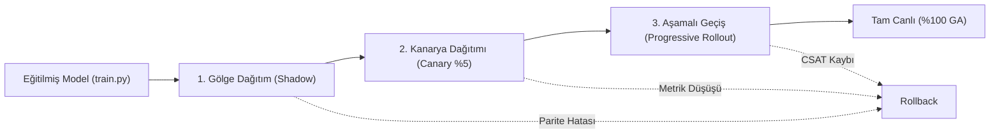

# SE Primer v2.0 Dağıtım, Sürümleme ve Mimari Karar Raporu (RELEASE.md)

Bu doküman, **SE Primer: Night Shift** uygulamasının kural tabanlı `v1.0` sürümünden, istemci tarafında makine öğrenmesi destekli adaptif çıkarım yapan `v2.0` sürümüne geçiş mimarisini, dağıtım stratejilerini ve mühendislik ödünleşimlerini (trade-offs) belgeler.

---

## 1. Sürüm Özeti (v2.0 Release Notes)

* **Eski Durum (v1.0):** Girişteki statik 3 soruya (Seviye, Rol, Hedef) bağlı kural tabanlı (`if/else`) karar ve ipucu akışı.
* **Yeni Durum (v2.0):** Kullanıcının kriz anındaki anlık davranışsal telemetrisinden (karar süresi, tıklama kararsızlığı, ipucu talebi, hata geçmişi) öğrenen, tarayıcıda sıfır gecikmeyle koşan **Bilişsel Aşırı Yüklenme ve Panik Tahmini Modeli (COPP - `model.onnx`)**.
* **Model Artefaktları:**
  - `model/model.onnx`: Scikit-learn Pipeline'ından dönüştürülmüş 10 KB boyutunda hafif tensör modeli.
  - `model/config.json`: Girdi özellikleri, veri tipleri ve kabul eşiklerini bağlayan sözleşme/JSON şeması.
  - `model/README.md`: Mitchell vd. (2019) standartlarında hazırlanmış model kartı.
* **Hugging Face Model Reposu ve Commit Pinning:**
  Tüketiciler modeli kontrolsüz `main` dalından değil, doğrulanmış ve dondurulmuş commit hash'i üzerinden indirir:
  ```text
  https://huggingface.co/Fatih162/se-primer-panic-onnx/resolve/36bff0c0cdbe2887ea05a0f71e0afd53209921d2/model.onnx
  ```

---

## 2. Geri Alma (Rollback) Planı

Üretim ortamında (production) modelde sürüklenme (concept drift), istemci tarafı WebAssembly bellek sızıntısı veya diferansiyel parite sapması ($> 10^{-4}$) tespit edildiğinde uygulanacak 2 kademeli geri alma prosedürü:

1. **Uygulama İçi Özellik Bayrağı (Feature Flag Fallback):**
   - `config.json` içinde yer alan `USE_ML_INFERENCE: true` bayrağı istemci tarafında anında `false` değerine çekilir.
   - Sistem hiçbir servis kesintisi yaşamadan saniyenin binde birinde `v1.0` deterministik kural motoruna geri döner (Graceful Degradation).
2. **Model Commit Geri Alma (Model Hash Pin Rollback):**
   - Yeni eğitilen bir model sürümünde hata gözlenirse, uygulama yapılandırmasındaki ONNX indirme URL'i bir önceki stabil commit hash'ine (`commit_v2.0.0_stable`) sabitlenir.

---

## 3. Yeni Sürümü Güvenle Devreye Alma Planı (Safe Deployment)

Amershi vd. (2019) ve Shankar vd. (2022) tarafından vurgulanan üretimde ML yaşam döngüsünün **3V (Velocity, Validation, Versioning)** ilkeleri doğrultusunda, model doğrudan tüm kullanıcılara açılmaz; 3 aşamalı güvenli dağıtım boru hattından geçirilir:



### Aşama 1: Shadow Deployment (Gölge Dağıtım)
- **Çalışma Şekli:** `model.onnx` tarayıcıda arka planda sessizce (silent mode) çalıştırılır. Model telemetriyi okur ve panik olasılığını hesaplar.
- **Kullanıcı Etkisi:** Sıfır. Arayüzde hiçbir değişiklik yapılmaz; eski kural motoru kararları vermeye devam eder.
- **Değerlendirme Kriteri:** Modelin tahmin ettiği panik durumları ile oyuncunun gerçekte yaptığı hatalı/başarılı kararlar loglarda çapraz karşılaştırılır. Modelin yanlış alarm (False Positive) oranı %5'in altındaysa 2. aşamaya geçilir.

### Aşama 2: Canary Deployment (Kanarya Dağıtımı)
- **Çalışma Şekli:** Canlı kullanıcı trafiğinin rastgele **%5'lik** dilimine model kararları aktif edilir.
- **Kullanıcı Etkisi:** Sadece %5'lik grupta model aşırı yüklenme tespit ettiğinde Sokratik mentor otomatik devreye girer.
- **Güvenlik Kriteri:** Sentry ve telemetri loglarında istemci tarafı CPU/RAM artışı veya WebAssembly çökmesi aranır.

### Aşama 3: Progressive Rollout (Aşamalı Geçiş)
- **Çalışma Şekli:**
  1. Gün 1: Trafiğin **%25'i**
  2. Gün 2: Trafiğin **%50'si**
  3. Gün 3: Trafiğin **%100'ü (General Availability - GA)**
- **İzleme:** Her aşamada oyuncuların oyunu tamamlama oranı (completion rate) ve CSAT skoru izlenir; düşüş olursa anında bayrak kapatılır.

---

## 4. Mimari Dağıtım Kararı ve Ödünleşim (Trade-off) Matrisi

Derste ele alınan 3 temel soru ekseninde, modeli çalıştırabileceğimiz 3 farklı mimarinin karşılaştırması:

| Değerlendirme Ekseni | 1. Tarayıcı İçi Çıkarım (`onnxruntime-web`) [Seçilen Mimari] | 2. Mobil Cihaz İçi Gömülü (`React Native / Expo`) | 3. Kendi Sunucumuz (`Render.com / Rails / FastAPI`) |
|---|---|---|---|
| **1. İnternet Zorunlu mu ve Gecikme (Latency)?** | **İnternetsiz:** İlk 10 KB indikten sonra sıfır ağ ihtiyacı. Çıkarım süresi **< 2ms**. Sunucu maliyeti sıfır. | **Tamamen Çevrimdışı:** Model APK/IPA içine gömülüdür, ilk kurulum sonrası ağ asla gerekmez. Gecikme **< 1ms**. | **Ağ Zorunlu:** Her karar anında sunucuya HTTP/WebSocket isteği atılır. Ağ gecikmesi **50ms – 300ms** ekler; çevrimdışıyken oyun kilitlenir. |
| **2. Veri Cihazdan Çıkar mı? (Gizlilik & KVKK)** | **Cihazda Kalır:** Oyuncunun karar süresi, tıklama titreşimleri ve tereddütleri istemci RAM'inde işlenir; hiçbir sunucuya uçmaz. **Tam KVKK uyumu.** | **Cihazda Kalır:** Telemetri tamamen cihaz içinde işlenir, harici sunucu sızıntısı riski yoktur. | **Cihazdan Çıkar:** Karar anındaki mikro davranışlar ağ üzerinden sunucuya iletilmek zorundadır. Veri aktarımı ve sunucu log güvenliği riski doğar. |
| **3. Model Gizli Kalır mı? (IP & Tersine Mühendislik)** | **Açık (Feragat Edilen Risk):** `model.onnx` tarayıcıya indiği için tersine mühendislikle kopyalanabilir. (Eğitim amaçlı açık kaynak bir projede bu kabul edilebilir bir ödünleşimdir). | **Kısmen Gizli:** Uygulama paketinde derlenmiş ikili dosya içinde saklanır; çıkartılması daha zordur. | **Tamamen Gizli:** Model sunucu tarafında saklanır, istemci modeli asla göremez. Yalnızca istek-yanıt analiziyle yaklaşık davranış çıkarılabilir. |

### Nihai Mühendislik Karar Gerekçesi:
SE Primer için **Tarayıcı İçi Çıkarım (`onnxruntime-web`)** seçilmiştir. Çünkü:
1. **Stanford AI Index 2025** raporunun gösterdiği üzere, çıkarım maliyetlerini sıfıra indirmek ve kullanıcıya anlık interaktif refleks sunmak modern eğitim simülatörlerinin temelidir.
2. 10 KB'lık dikey bir model için sunucu ayak izi (server footprint) oluşturmak gereksiz bir altyapı karmaşıklığıdır.
3. KVKK ve etik gizlilik açısından oyuncunun karar anındaki tereddütlerinin sunucuya gönderilmeyip cihazda tutulması en güvenli yoldur.

---

## 5. Referanslar
1. **Amershi, S. vd. (2019):** *Software Engineering for Machine Learning: A Case Study*, Microsoft Software Engineering Case Studies.
2. **Shankar, S. vd. (2022):** *Operationalizing Machine Learning: An Interview Study* (Production ML 3V: Velocity, Validation, Versioning).
3. **Mitchell, M. vd. (2019):** *Model Cards for Model Reporting*, FAT* '19 Proceedings.
4. **Sommerville, I.:** *Software Engineering (10th Edition)* — Ch. 8 Software Testing (V&V), Ch. 25 Configuration Management.
5. **Stanford HAI (2025):** *Artificial Intelligence Index Report* (300x inference cost reduction trend).
