# SE Primer: "Night Shift: Season 5 Zero Hour"
## Yazılım Mühendisliği İnteraktif Durum & Öğrenme Simülatörü

---

### 1. Problem Tanımı
Modern yazılım mühendisliği eğitiminde ve operasyonel hazırlıkta en büyük eksiklik, kriz anındaki teknik kararların (mimari, test, veri bütünlüğü) zincirleme etkilerini güvenli bir ortamda deneyimleyememektir. Kod yazımı yapay zekâ ile büyük oranda otomatikleşirken, mühendisin asıl kritik rolü **spesifikasyon**, **ürün kararı** ve **doğrulama** haline gelmiştir.

Bu uygulama, **Neal Stephenson'ın *The Diamond Age*** eserindeki uyarlanabilir kitap ("Illustrated Primer") konseptini ve **Y Combinator 2026 Primer** vizyonunu temel alarak; çok oyunculu bir oyun altyapısının sezon açılışında çökmesi senaryosu üzerinden mühendise kararlarının teknik ve ekonomik sonuçlarını yaşatan, Sokratik bir AI rehberiyle desteklenen etkileşimli bir simülasyondur.

---

### 2. Kapsam ve Kapsam Dışı (Scope & Out-of-Scope)

#### 2.1. Kapsam İçi (In-Scope)
1. **Mobil Öncelikli Web Deneyimi:** Google AI Studio / Web ortamında çalışan, telefon boyutuna (360x740px ve üzeri) optimize arayüz.
2. **Kişiselleştirilmiş Başlangıç:** Oyuncunun seviyesi (Junior / Senior), rolü (Backend Mühendisi / SRE / Dağıtık Sistem Mimarı) ve hedefi doğrultusunda anlatının tonu ve kısıtları uyarlanır.
   - *Junior:* Kavramsal açıklamalar ve yönlendirici Sokratik ipuçları aktif.
   - *Senior:* 60 saniyelik karar sayacı baskısı ve ileri düzey dağıtık sistem terimleri.
3. **1 Canlı Kriz Senaryosu:** 250.000 eşzamanlı oyuncunun bağlandığı Sezon 5 açılışında WebSocket ağ geçidi çökmesi ve envanter desenkronizasyonu krizi.
4. **3 Aşamalı Teknik Karar Ağacı:**
   - **Karar 1 (Mimari & Trafik):** Tam Kapatma (Bakım Modu & Snapshot Rollback) vs. Dinamik Kuyruk (Rate-Limiter & Canlı Hotfix).
   - **Karar 2 (Test & Doğrulama):** 10.000 Bot ile Staging Yük Testi vs. Doğrudan Canlıya Dağıtım (Zero-Validation Deployment).
   - **Karar 3 (Veri Bütünlüğü & Hukuk/Ekonomi):** Dupe (Kopya) Eşyaları Loglardan Ayıklama & Telafi vs. Hızlı Geçiş & Ekonomik Devalüasyon Riski.
5. **Neden-Sonuç Geri Bildirimi:** Her seçimden sonra ekranda *"Ne Oldu?"* ve *"Neden Oldu?"* teknik analiz kutuları.
6. **2 Farklı Nihai Durum (Son):**
   - *Son A (Başarılı / İyi Son):* "Sunucular Stabil, Ekonomi Güvende, Sıfır Veri Kaybı."
   - *Son B (Felaket / Kötü Son):* "Ekonomi Çöktü, Envanterler Silindi, Oyuncu İsyanı."
7. **Sokratik AI Tutor Modu:** Oyuncuya doğrudan doğru şıkkı asla söylemeyen, yalnızca karşı soru sorarak düşündüren rehber.

#### 2.2. Kapsam Dışı (Out-of-Scope)
1. Kullanıcı kaydı, parola yönetimi, oturum açma (Auth/Login/SSO).
2. Gerçek oyun istemcisi veya native mobil uygulama (Flutter/React Native/iOS/Android derlemesi).
3. 2. Bölüm veya alternatif harici senaryolar (Tek kriz üzerinde derinleşilecektir).
4. Gerçek oyuncu/kredi kartı verileri veya gerçek ödeme API entegrasyonu.
5. Arka planda gerçek yüzbinlerce soket bağlantısı yöneten fiziksel bir oyun motoru (Uygulama durum makinesi üzerinden simülasyon yürütür).

---

### 3. Kabul Kriterleri (Acceptance Criteria - Given / When / Then)

#### Kabul Örneği 1: Kişiselleştirme Girişi ve Durum Başlatma
* **Given (Koşul):** Kullanıcı uygulamayı ilk kez mobil tarayıcıda açtığında,
* **When (Eylem):** Seviyesini "Junior", rolünü "Oyun Sunucusu Mühendisi", hedefini "Sıfır Veri Kaybı" olarak seçip "Simülasyonu Başlat" butonuna tıkladığında,
* **Then (Beklenen Sonuç):** Sistem durumu `SCENE_CRISIS` durumuna geçer; ekranda 21:00 kriz brifingi görünür ve AI Tutor "Junior" seviyesine uygun olarak kavramsal yardım ipucu butonu sunar (Sayaç kısıtı kaldırılır).

#### Kabul Örneği 2: Karar 1 Mimari Seçimi ve Neden-Sonuç Bildirimi
* **Given (Koşul):** Kullanıcı Karar 1 (Mimari & Trafik) ekranındayken,
* **When (Eylem):** "B Şıkkı: Lobileri Dinamik Kuyruğa Al ve Canlı Hotfix Hazırla" seçeneğine tıkladığında,
* **Then (Beklenen Sonuç):** Sistem durumu `DECISION_1_RESULT` durumuna geçer; "Ne Oldu?" başlığında sunucuların çökmeden kuyruk oluşturduğu, "Neden Oldu?" başlığında ise backpressure ve graceful degradation mimarisinin veritabanını kurtardığı açıklanır.

#### Kabul Örneği 3: Karar 2 Test Doğrulaması (Kötü Yol Seçimi)
* **Given (Koşul):** Kullanıcı Karar 2 (Test & Doğrulama) ekranındayken,
* **When (Eylem):** "B Şıkkı: Test Koşmadan Doğrudan Canlıya Sür (Zaman Yok)" seçeneğini seçtiğinde,
* **Then (Beklenen Sonuç):** Sistem regresyon hatasını tespit eder; lobi kilitlenmesi çözülse bile eşya kopyalama (item duplication race condition) hatasının canlıya yayıldığı geri bildirimi gösterilir ve oyuncu `DECISION_3_DATA` adımına riskli bir bayrakla (`hasDupeBug = true`) geçer.

#### Kabul Örneği 4: Sokratik AI Tutor Kuralı (Cevap Vermeme Kısıtı)
* **Given (Koşul):** Kullanıcı herhangi bir karar anında AI Tutor sohbet penceresini açtığında,
* **When (Eylem):** "Hangi seçeneği seçmeliyim? Doğru cevap hangisi?" sorusunu girdiğinde,
* **Then (Beklenen Sonuç):** AI Tutor asla "A şıkkını seç" veya "B daha iyi" yanıtını vermez. Yanıt olarak: "Geri dönmeden önce, son 20 dakikada gerçek para yatıran oyuncuların veritabanı işlemlerini nasıl koruyacaksın?" şeklinde Sokratik bir soru yöneltir.

#### Kabul Örneği 5: Çift Sonuç ve Durum Makinesi Bitişi
* **Given (Koşul):** Kullanıcı 3 kararı da tamamladığında,
* **When (Eylem):** Yaptığı seçimler veri bütünlüğünü ve test disiplinini koruyorsa (en az 2 doğru teknik karar),
* **Then (Beklenen Sonuç):** Sistem durumu `RESULT_GOOD` olur ve "Başarı: Sezon 5 Kurtarıldı" raporu ve rozeti verilir; aksi takdirde `RESULT_BAD` ("Ekonomi Çöktü") ekranı detaylı post-mortem analiziyle sunulur.

---

### 4. Durum Makinesi ve Akış Şeması (State Diagram)

```mermaid
stateDiagram-v2
    [*] --> ONBOARDING: Uygulama Başlatma

    state ONBOARDING {
        [*] --> Q1_LEVEL: Seviye Seçimi (Junior / Senior)
        Q1_LEVEL --> Q2_ROLE: Rol Seçimi (Backend / SRE / Mimar)
        Q2_ROLE --> Q3_GOAL: Hedef Seçimi (Sıfır Kayıp / Hızlı Dönüş)
        Q3_GOAL --> [*]: Başlat Butonu
    }

    ONBOARDING --> CRISIS_INTRO: Profil Kaydedildi & Senaryo Yüklendi

    state CRISIS_INTRO {
        [*] --> BRIEFING: "21:00 - Sezon 5 Sunucuları Kilitlendi!"
        BRIEFING --> DECISION_1: Müdahale Et
    }

    state DECISION_1 {
        [*] --> ARCH_CHOICE: Mimari & Trafik Kararı
        ARCH_CHOICE --> OPTION_1A: A) Tam Kapatma & Rollback
        ARCH_CHOICE --> OPTION_1B: B) Dinamik Kuyruk & Canlı Hotfix
    }

    OPTION_1A --> FEEDBACK_1A: Rollback Neden-Sonuç Bildirimi
    OPTION_1B --> FEEDBACK_1B: Kuyruk Neden-Sonuç Bildirimi

    FEEDBACK_1A --> DECISION_2
    FEEDBACK_1B --> DECISION_2

    state DECISION_2 {
        [*] --> TEST_CHOICE: Doğrulama & Test Kararı
        TEST_CHOICE --> OPTION_2A: A) 10k Bot ile Staging Yük Testi
        TEST_CHOICE --> OPTION_2B: B) Testi Atla & Canlıya Sür
    }

    OPTION_2A --> FEEDBACK_2A: Test Analizi (Tutarlı & Güvenli)
    OPTION_2B --> FEEDBACK_2B: Test Analizi (Dupe Bug Canlıya Geçti)

    FEEDBACK_2A --> DECISION_3
    FEEDBACK_2B --> DECISION_3

    state DECISION_3 {
        [*] --> DATA_CHOICE: Veri Bütünlüğü & Ekonomi Kararı
        DATA_CHOICE --> OPTION_3A: A) Log Taraması & Dupe Hesapları Dondurma
        DATA_CHOICE --> OPTION_3B: B) Logları Yok Say & Hızlı Geçiş
    }

    OPTION_3A --> FEEDBACK_3A: Ekonomi Güvende Analizi
    OPTION_3B --> FEEDBACK_3B: Piyasa Enflasyonu Analizi

    FEEDBACK_3A --> EVALUATE_OUTCOME
    FEEDBACK_3B --> EVALUATE_OUTCOME

    state EVALUATE_OUTCOME <<choice>>
    EVALUATE_OUTCOME --> RESULT_GOOD: Teknik Puan >= 70 (Stabilite & Veri Tam)
    EVALUATE_OUTCOME --> RESULT_BAD: Teknik Puan < 70 (Ekonomi / İtibar Kaybı)

    RESULT_GOOD --> POST_MORTEM
    RESULT_BAD --> POST_MORTEM

    state POST_MORTEM {
        [*] --> REVIEW: Karar Analizi & Öğrenilen Dersler
        REVIEW --> RESTART: Yeniden Oyna
    }

    RESTART --> ONBOARDING
```

